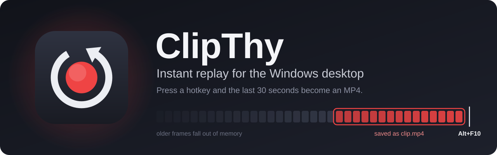
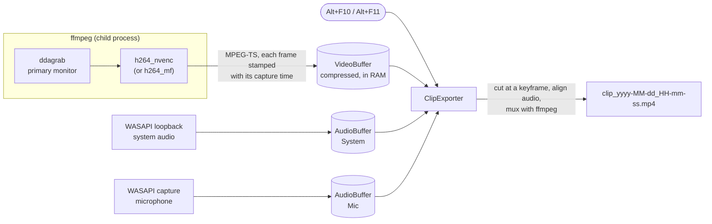

<p align="center">
  
</p>

<p align="center">
  <a href="https://github.com/ItzBloxy/ClipThy/releases/latest"></a>
  <a href="https://github.com/ItzBloxy/ClipThy/releases"></a>
  <a href="https://github.com/ItzBloxy/ClipThy/actions/workflows/ci.yml"></a>
  
  
  <a href="LICENSE"></a>
</p>

<p align="center">
  <b>Something cool just happened on screen? Press <kbd>Alt</kbd>+<kbd>F10</kbd>.</b><br>
  ClipThy sits in the tray and keeps the last 15–120 seconds of your screen, system audio and microphone in memory.<br>
  One keypress turns them into an MP4, ready to share a second or two later.
</p>

<p align="center">
  <a href="https://github.com/ItzBloxy/ClipThy/releases/latest"><b>⬇ Download for Windows</b></a>
  &nbsp;·&nbsp; <a href="#quick-start">Quick start</a>
  &nbsp;·&nbsp; <a href="#configuration">Configuration</a>
  &nbsp;·&nbsp; <a href="#troubleshooting">Troubleshooting</a>
  &nbsp;·&nbsp; <a href="#how-it-works">How it works</a>
</p>

---

## Why ClipThy

Big recording suites are built for streaming. ClipThy does one thing, instant replay, and tries to cost you nothing until you use it.

|  |  |
|---|---|
| ⚡ **Hardware encoded** | H.264 on your GPU (NVIDIA NVENC, with an automatic Media Foundation fallback). Frames go straight from the screen to the encoder and never touch the CPU. |
| 🪶 **Featherweight** | Measured on a 16-thread PC: **0.4 % of one CPU core** and **~190 MB of RAM** (app plus ffmpeg) with a 30 s buffer. Nothing is written to disk until you save. |
| 🎯 **In sync, every time** | Video and both audio sources are stamped on one capture clock and aligned when you save, so encoder delay can't knock lip-sync out. Measured offset in testing: +9 ms. |
| 🎚️ **Editor-friendly tracks** | <kbd>Alt</kbd>+<kbd>F10</kbd> saves one mixed track. <kbd>Alt</kbd>+<kbd>F11</kbd> saves three: **Mix**, **System** and **Mic**, so you can fix levels later. |
| 🎞️ **Smooth 60 fps** | Gives ffmpeg a 1 ms Windows timer, which took skipped frames from 4–5 % to **zero** in testing. |
| 🔁 **Hands-off** | Recovers on its own from sleep, lock/unlock, resolution changes, clock changes, ffmpeg crashes and headsets being unplugged. |
| 📁 **ShareX-style folders** | Clips land in `Documents\ShareX\Screenshots\2026-10\clip_2026-10-19_17-42-08.mp4`. Click the notification and Explorer opens with the clip selected. |
| 🔒 **Private by design** | No network access, no telemetry, no account. Audio and video stay in RAM until you press the hotkey. |

## Quick start

> [!IMPORTANT]
> ClipThy needs **ffmpeg 8** on your PATH. It isn't bundled, because you choose which build you install.

1. **Install ffmpeg.** The tested build is gyan.dev's full build, available through winget:
   ```powershell
   winget install Gyan.FFmpeg
   ```
   Check it with `ffmpeg -version` in a **new** terminal.

2. **Download ClipThy** from the [latest release](https://github.com/ItzBloxy/ClipThy/releases/latest):

   | Download | Size | Use it if… |
   |---|---|---|
   | `ClipThy-x.y.z-win-x64.zip` | ~44 MB | **Recommended.** Self-contained, so nothing else to install. |
   | `ClipThy-x.y.z-win-x64-framework-dependent.zip` | <1 MB | You already have the [.NET 10 Desktop Runtime](https://dotnet.microsoft.com/download/dotnet/10.0). |

3. **Unzip it somewhere permanent**, for example `%LOCALAPPDATA%\Programs\ClipThy`, and run `ClipThy.exe`.
   A **red dot** appears in the tray: you're recording.

4. **Press <kbd>Alt</kbd>+<kbd>F10</kbd>.** A soft chime plays, a notification says *Clip saved – 30 s*, and the clip is in your clips folder.

> [!NOTE]
> The exe isn't code-signed, so Windows SmartScreen may say *"Windows protected your PC"* the first time. Click **More info → Run anyway**. You can check the download against `SHA256SUMS.txt` from the release.

> [!TIP]
> ClipThy adds itself to **Start with Windows** on first run, so it's always ready. Untick it in the tray menu if you'd rather start it yourself.

## Using ClipThy

### Hotkeys

| Keys | Saves |
|---|---|
| <kbd>Alt</kbd>+<kbd>F10</kbd> | The last *N* seconds with **one** audio track: system audio and mic mixed together. Plays everywhere. |
| <kbd>Alt</kbd>+<kbd>F11</kbd> | The same clip with **three** audio tracks: `1 Mix` (default), `2 System`, `3 Mic`. Players use track 1; editors such as DaVinci Resolve, Premiere or Shotcut show all three. |

Both are global (they work in games and fullscreen apps) and can be changed in [`config.json`](#configuration). Holding the keys down saves once. Up to three saves can queue while one is being written.

### The tray icon

```
 🔴  ClipThy – recording (30 s, NVENC)          ← tooltip

     Clip length          ▸  15 s · 30 s ✓ · 60 s · 120 s
     Save clip now
     Open clips folder
     Start with Windows   ✓
     ─────────────────
     Exit
```

- **Left-click** the icon to show the last clip in Explorer. Before the first save, it opens the clips folder.
- **Red dot** means recording. **Grey** means paused (the PC is locked), restarting, or an error; hover for the reason.
- **Clip length** applies immediately. A longer length fills up as time passes.
- **Exit** waits up to 10 seconds for saves that are still being written.

### What you get

| | |
|---|---|
| **File** | `<clips folder>\yyyy-MM\clip_yyyy-MM-dd_HH-mm-ss.mp4`, named after the moment you pressed the key. A clash gets `_2`, `_3`… |
| **Video** | H.264, primary monitor at native resolution, 60 fps, 20 Mbps VBR, mouse cursor included |
| **Audio** | AAC 192 kbps, 48 kHz stereo |
| **Length** | The clip length you chose, extended back to the previous keyframe, so up to 1 s longer (a 30 s clip is 30.1–30.7 s) |
| **Speed** | A 30 s clip is ready about **1–2 seconds** after the keypress. Saving happens in a temp folder, so a half-written file never appears in your clips folder. |

## Configuration

Settings live in **`%APPDATA%\ClipThy\config.json`**, created with these defaults on first run:

```jsonc
{
  "clipSeconds": 30,                 // 5–120. The tray offers 15 / 30 / 60 / 120
  "hotkeyMixed": "Alt+F10",          // one mixed audio track
  "hotkeyMultitrack": "Alt+F11",     // Mix + System + Mic tracks
  "outputRoot": "C:\\Users\\you\\Documents\\ShareX\\Screenshots",
  "encoder": "auto",                 // auto | nvenc | mf
  "fps": 60,                         // 30 or 60
  "videoBitrateMbps": 20,            // 2–100 (bursts up to 1.5x)
  "playSound": true,                 // the "clip saved" chime
  "ffmpegPath": "ffmpeg"             // or a full path to ffmpeg.exe
}
```

- **Exit ClipThy before editing.** Hand edits apply at the next start, and changing the clip length from the tray rewrites the file.
- **Invalid values** fall back to their default with a warning notification. A file that isn't valid JSON is kept as `config.json.bad` and replaced with defaults.
- **`encoder`**: `auto` tries NVENC and switches to Media Foundation for the session if NVENC can't start. `nvenc` and `mf` force one encoder with no fallback.
- **Hotkeys** are modifiers plus a key, joined with `+`. Modifiers are `Ctrl`, `Alt`, `Shift` and `Win`; keys use [Windows Forms key names](https://learn.microsoft.com/dotnet/api/system.windows.forms.keys) such as `F1`–`F24`, `A`–`Z`, `0`–`9`, `NumPad5`, `Insert`, `Home` or `PrintScreen`. Examples: `Ctrl+Shift+S`, `Ctrl+Alt+F10`, `Win+F9`. A key with no modifier, such as `F9`, works too, but then no other program gets that key.
- **Memory grows with clip length × bitrate**, which is why the maximum is 120 s (see [Performance](#performance)).

### Files and folders

| What | Where |
|---|---|
| Settings | `%APPDATA%\ClipThy\config.json` |
| Log (rolls over at 1 MB) | `%LOCALAPPDATA%\ClipThy\clipthy.log` |
| Clips | `outputRoot\yyyy-MM\` (default `Documents\ShareX\Screenshots\yyyy-MM\`) |
| Temporary save files | `%TEMP%\ClipThy\` (removed after each save and at startup) |
| Start with Windows | Registry value `ClipThy` in `HKCU\Software\Microsoft\Windows\CurrentVersion\Run` |

## Requirements

| | |
|---|---|
| **Windows** | Windows 10 or 11, 64-bit. Developed and tested on Windows 10 22H2; Windows 11 should work but hasn't been tested yet. |
| **GPU** | A GPU with a hardware H.264 encoder. **NVIDIA** (NVENC) is tested and needs driver **570 or newer** for ffmpeg 8. AMD and Intel GPUs should work through the Media Foundation fallback but haven't been tested yet. If ClipThy doesn't switch on its own, set `"encoder": "mf"`. Reports are welcome. |
| **ffmpeg** | **8.x** with `ddagrab`, `h264_nvenc` / `h264_mf`, `amix` and `alimiter`. gyan.dev's full build (`winget install Gyan.FFmpeg`) has all of them. |
| **.NET** | Nothing for the self-contained download; the .NET 10 Desktop Runtime for the framework-dependent one. |

## Performance

Measured on the development PC (16 threads, RTX 3070) recording 2560×1440 at 60 fps with a 30 s clip length:

| | ClipThy | ffmpeg | Together |
|---|---|---|---|
| CPU (share of one core) | 0.18 % | 0.21 % | **0.39 %** (0.02 % of the whole 16-thread CPU) |
| Memory (working set) | ~72 MB | ~114 MB | **~186 MB**, the same before and after a save |
| Disk | — | — | Nothing written except when saving and logging |

Most of the memory is the compressed video buffer, which grows with clip length and bitrate:

| Clip length | Video buffer at 20 Mbps | Worst case (30 Mbps bursts) | Audio buffers |
|---|---|---|---|
| 30 s | ~80 MB | ~120 MB | ~13 MB |
| 120 s | ~305 MB | ~460 MB | ~47 MB |

Static screens use far less. With a 120 s length, expect about 0.5–0.7 GB in total.

## Troubleshooting

<details>
<summary><b>"ClipThy hotkey unavailable" at startup</b></summary>

Another program registered the same keys first. **NVIDIA's overlay uses <kbd>Alt</kbd>+<kbd>F10</kbd> for Instant Replay**, so this is the usual culprit. Either turn off Instant Replay's hotkey in the NVIDIA app, or exit ClipThy and set another `hotkeyMixed` in `config.json`. *Save clip now* in the tray menu works either way.
</details>

<details>
<summary><b>"ClipThy can't capture the screen", or the tooltip shows an error</b></summary>

- **ffmpeg not found:** run `ffmpeg -version` in a new terminal. If you've just installed it, sign out and back in so ClipThy sees the new PATH, or put the full path in `ffmpegPath`.
- **No hardware encoder:** ClipThy refuses to fall back to slow software encoding. Check that your GPU driver is current; NVENC in ffmpeg 8 needs NVIDIA driver 570+.
- The exact ffmpeg error is in `%LOCALAPPDATA%\ClipThy\clipthy.log`.
</details>

<details>
<summary><b>"Switched to Media Foundation" notification</b></summary>

NVENC couldn't start, usually because a newer ffmpeg needs a newer NVIDIA driver. ClipThy keeps recording through Media Foundation on the same GPU for this session. Update your driver to get NVENC back.
</details>

<details>
<summary><b>Clips stutter or skip frames</b></summary>

ClipThy gives its ffmpeg a 1 ms Windows timer: it starts one thread inside ffmpeg that calls `timeBeginPeriod(1)`. If security software blocks that, the log says so, and capture continues on Windows' default 15.6 ms timer, which skips about 4–5 % of frames at 60 fps. Allow ClipThy in your security software, or set `"fps": 30`, which skips almost nothing on the default timer.
</details>

<details>
<summary><b>My antivirus flags ClipThy</b></summary>

That's the same 1 ms timer trick: starting a thread in another process is something security tools watch for. ClipThy only does it to its own child `ffmpeg.exe`, and the thread only calls `kernel32!timeBeginPeriod`. Nothing is written into ffmpeg's memory. The code is in [`ProcessTimerResolution.cs`](src/ClipThy/Infrastructure/ProcessTimerResolution.cs), and you can build ClipThy yourself from source.
</details>

<details>
<summary><b>Colours look washed out</b></summary>

- **Windows HDR is on:** ClipThy records 8-bit SDR, so HDR desktops look flat. Turn HDR off while clipping.
- **A player ignores colour tags:** clips are tagged correctly (BT.601 matrix, BT.709 primaries and transfer), and browsers, Discord and Windows Photos respect the tags. A player that ignores them shows slightly shifted colours.
</details>

<details>
<summary><b>Video is black</b></summary>

DRM-protected video (Netflix in a browser, for example) is blacked out by Windows for every screen recorder. While the PC is locked, nothing is recorded at all.
</details>

<details>
<summary><b>The mic track is silent</b></summary>

ClipThy shows a notification when it can't use the mic. Check **Settings → Privacy → Microphone → Allow desktop apps to access your microphone**, and that a default recording device is set. The silent track stays in place, so Alt+F11 clips always have the same layout.
</details>

<details>
<summary><b>Other sounds get quieter while ClipThy runs</b></summary>

Windows may treat an always-open microphone as a "communications" call. Run `mmsys.cpl`, open the **Communications** tab and pick **Do nothing**.
</details>

<details>
<summary><b>The chime is in my next clip</b></summary>

The chime is system audio, so it's recorded like everything else. Set `"playSound": false` if that bothers you. The notification still appears, although Focus Assist hides notifications during fullscreen games by default.
</details>

<details>
<summary><b>The microphone-in-use icon is always on</b></summary>

That's expected: the last *N* seconds of mic audio are always being buffered (in RAM only). Exit ClipThy to release the mic.
</details>

Still stuck? [Open an issue](https://github.com/ItzBloxy/ClipThy/issues/new/choose) and include the relevant part of `clipthy.log`.

## How it works

ClipThy captures video and audio separately and joins them only when you save.



1. **Video:** a long-running `ffmpeg` grabs the primary monitor with Desktop Duplication (`ddagrab`) and encodes it on the GPU. Frames stay in video memory until they're encoded. Each frame is stamped with the wall-clock time it was captured.
2. **Audio:** ffmpeg can't record system audio on Windows, so ClipThy captures it with WASAPI: loopback for what you hear, plus the default mic. Each packet keeps its hardware capture timestamp, is converted to 48 kHz stereo and stored in a pooled ring buffer.
3. **One timeline:** all three streams are mapped onto Windows' high-resolution performance counter. At save time the exporter cuts the video at a keyframe, then extracts *exactly* the same time span from both audio buffers. Sync doesn't depend on encoder delay, and clock drift can't build up over hours.
4. **Export:** ffmpeg copies the video without re-encoding and mixes the audio with `amix` plus a limiter to avoid clipping. It writes the MP4 in a temp folder at below-normal priority, and the finished file is moved into the clips folder.

The full design, including measurements, ffmpeg command lines and failure handling, is in [`docs/superpowers/specs/2026-09-30-clipthy-design.md`](docs/superpowers/specs/2026-09-30-clipthy-design.md).

## Building from source

You need the [.NET 10 SDK](https://dotnet.microsoft.com/download/dotnet/10.0) and, for the integration tests, ffmpeg on your PATH.

```powershell
git clone https://github.com/ItzBloxy/ClipThy.git
cd ClipThy
dotnet build -c Release
dotnet run --project src/ClipThy
```

### Tests

There are three groups of tests:

| Group | Needs | Command |
|---|---|---|
| Unit | nothing | `dotnet test --filter "Category!=Hardware&Category!=Integration"` |
| Integration | ffmpeg and a hardware H.264 encoder | `dotnet test --filter "Category=Integration"` |
| Hardware | a real display, speakers and microphone | `dotnet test --filter "Category=Hardware"` |

CI runs the unit tests on every push. Run the other two locally before a release.

### A/V sync check

```powershell
ClipThy.exe --sync-test     # a window that flashes and beeps once per second
```

While it runs, press <kbd>Alt</kbd>+<kbd>F11</kbd>, close the window, then analyse the clip:

```powershell
powershell -ExecutionPolicy Bypass -File tools\sync-check.ps1 -Clip "<path to the clip>"
```

It reports the mean audio/video offset and the dropped-frame count. It passes at |offset| ≤ 40 ms and ≤ 1 % dropped frames; the development PC measured +9.1 ms and 0.05 %.

### Packaging and releases

```powershell
powershell -ExecutionPolicy Bypass -File tools\package.ps1   # builds both zips and SHA256SUMS.txt into dist\
```

To publish a release, bump `<Version>` in `src/ClipThy/ClipThy.csproj`, add `docs/releases/vX.Y.Z.md` and a `CHANGELOG.md` entry, then push a `vX.Y.Z` tag. The [Release workflow](.github/workflows/release.yml) tests, packages and publishes it.

### Project layout

```
src/ClipThy/
  Audio/           WASAPI capture, format conversion, timestamped PCM ring buffer
  Video/           capture ffmpeg supervision, MPEG-TS parsing, frame buffer, encoder policy
  Export/          snapshot, mux and file naming
  Hotkeys/         global hotkey parsing and registration
  Config/          config.json loading and validation
  Timing/          the shared capture clock
  Infrastructure/  log, autostart, job object, ffmpeg's 1 ms timer
  Tray/            tray icon, menu, notifications, chime, sync-test window
tests/ClipThy.Tests/   xUnit: unit, integration and hardware tests
tools/                 sync-check.ps1, package.ps1
docs/                  design spec and implementation plan
```

## Limitations

ClipThy is deliberately small. These are out of scope for now:

- Recording a second monitor, a window or a region (it records the primary monitor)
- Webcam overlay, trimming or editing, and uploading
- A settings window (`config.json` is the settings UI)
- HEVC, AV1 and HDR capture
- Per-application audio capture

## Uninstall

1. Right-click the tray icon, untick **Start with Windows**, then click **Exit**.
2. Delete the ClipThy folder.
3. Optionally delete `%APPDATA%\ClipThy` (settings) and `%LOCALAPPDATA%\ClipThy` (log). Your clips stay where they are.

## Licence

ClipThy is released under the [MIT licence](LICENSE). It uses [NAudio](https://github.com/naudio/NAudio) (MIT) and runs [FFmpeg](https://ffmpeg.org/), which you install separately under its own licence. See [THIRD-PARTY-NOTICES.md](THIRD-PARTY-NOTICES.md).

Folder and file naming follow [ShareX](https://getsharex.com/)'s conventions, so clips sit next to your screenshots.
